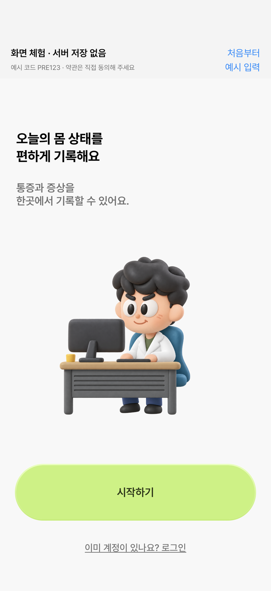
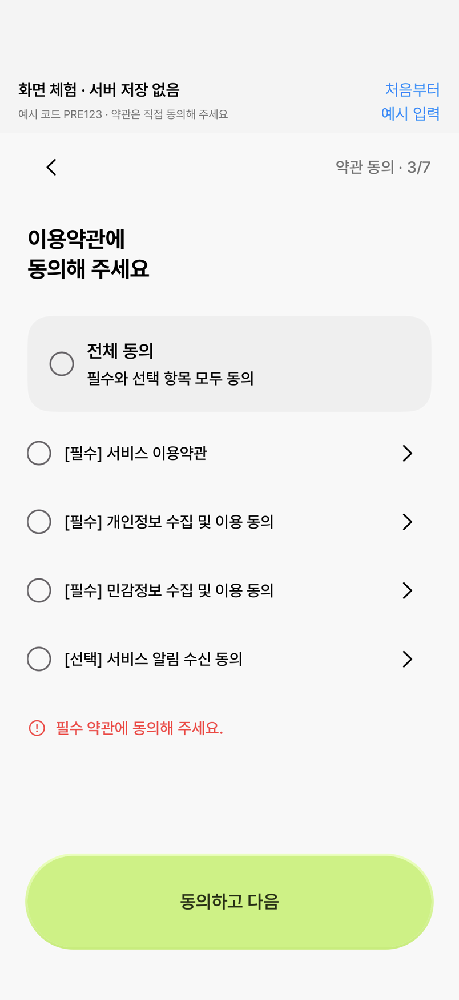
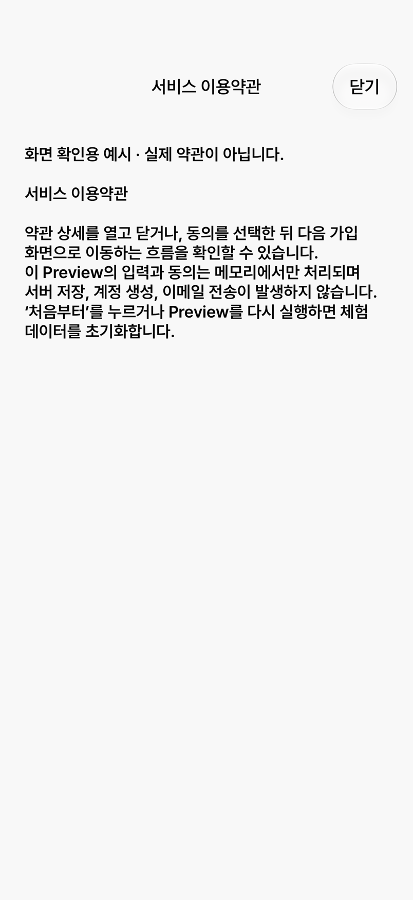
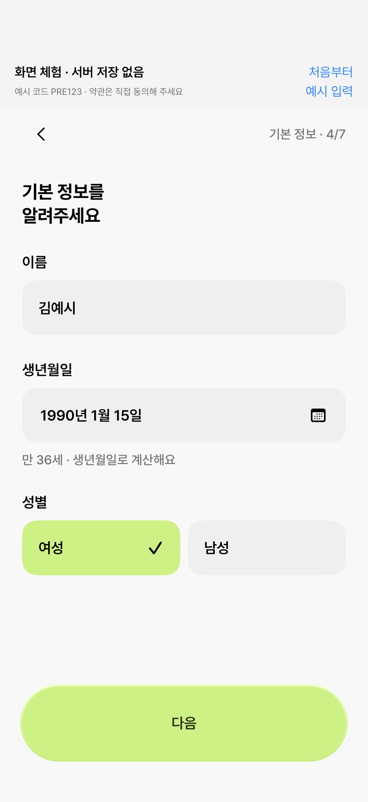
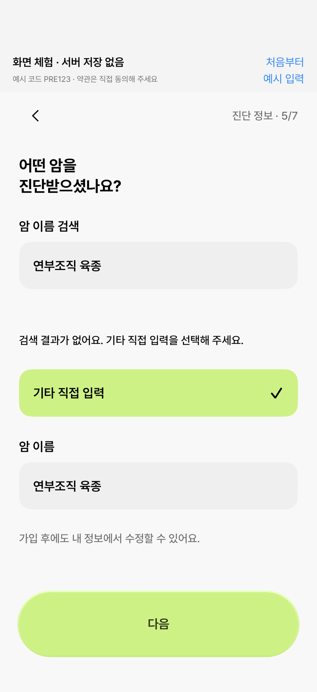
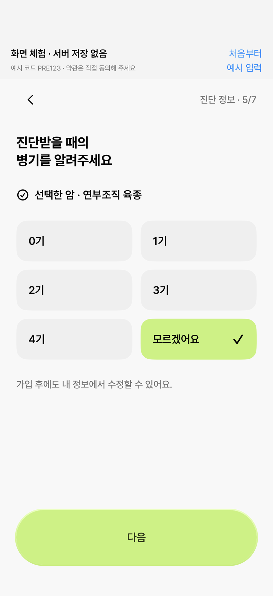
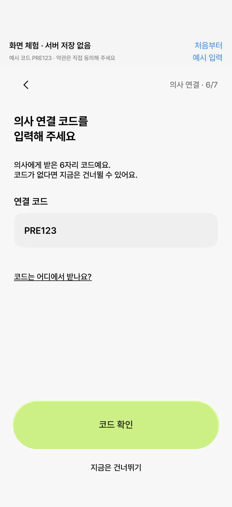
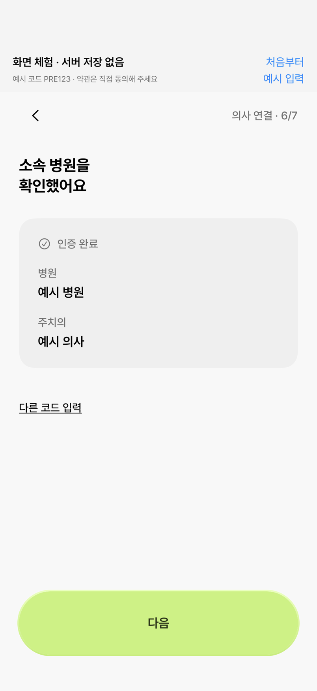
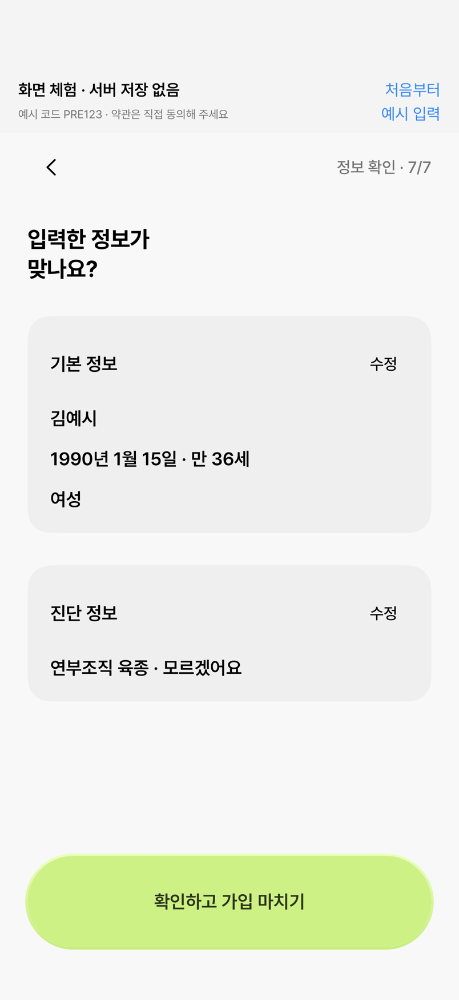
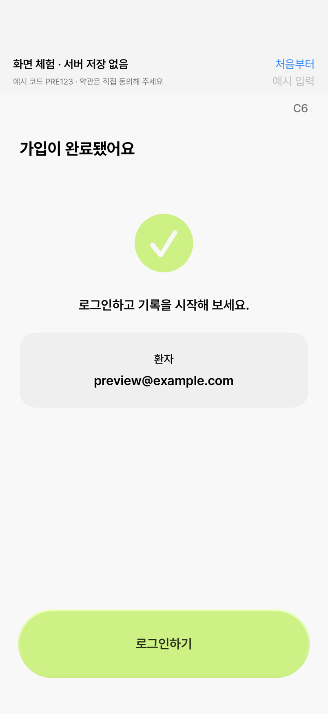

# 가입 Preview·암종 변경 화면

2026-10-18 · iPhone 18 Pro / iOS 27 · 실제 SwiftUI 렌더 10장.

DEBUG Preview의 예시 데이터입니다. 실제 계정 생성·메일 전송·서버 저장이 아닙니다. QA용 임시 호스트에서 제품 ViewModel 액션으로 단계를 진행했고, 약관 본문은 실제 TermsDetailView를 별도로 표시했습니다. 캡처는 현재 보이는 영역이며 모든 버튼의 직접 탭 검증을 의미하지 않습니다. 임시 호스트는 제품 코드에 포함하지 않았습니다.

가입 순서는 선행 #107에서 가져왔습니다. 이 PR의 추가 변경은 오프라인 Preview와 기타 암종·병기 모름 입력입니다.

검증: 전체 Swift 테스트 279개, Debug/Release 빌드 성공. 시뮬레이터 액션 검사 14항목 모두 통과(약관 미동의 차단, 기본 정보→암종→의사 코드, 기타 공백 차단, 코드 확인/건너뛰기, 가입 완료 및 기타 이름·unknown 메모리 저장 등). 기존 AI/Service 빌드 경고 4개는 유지됩니다. 실제 서버·실기기 검증은 하지 않았습니다.

## 온보딩 시작

## 필수 약관 동의 검사

## 예시 약관 본문

## 필수 기본 정보

## 기타 암종 자유 입력

## 병기 모르겠어요

## 선택 의사 코드

## 예시 코드 확인

## 최종 확인·기타 이름 보존

## 메모리 가입 완료

