# 환자 화면·디자인시스템 PR 화면 자료

2026-10-18, iPhone 18 Pro / iOS 27.0. 이 폴더의 17개 이미지는 Figma 그림이 아니라 실제 SwiftUI 화면을 Simulator에서 렌더한 결과입니다. 예시 이름·기록은 DEBUG Preview 데이터입니다.

진료 전 기록 → 알림 → 케어콜 음성·수동 → 통증 → 마이페이지 순서로 확인합니다. 홈 View·ViewModel은 포함하지 않습니다. `shared-controls.png`는 공통 입력/진행률, `voice-editing-large.png`는 320pt와 접근성 큰 글자 예시입니다. 스크롤 화면의 이미지는 현재 보이는 영역만 담았습니다.

- 전체 테스트 268개 통과 (XCTest105 + Swift Testing163).
- 실제 제품 소스 Debug/Release 빌드 통과. 기존 AI/Service 경고4개가 남습니다.
- 디자인시스템 활성72/보류7/위반0, 공통UI·diff 검사 통과.
- 독립 리뷰에서 Preview 알림 설정 취소를 마지막 저장값 복원으로 보완했습니다. 실제 PreviewData의 통증off→저장→케어콜off→취소 액션을 Simulator에서 실행하여 저장값 보존과 편집 상태 정리를 확인했습니다.
- 캡처 사본은 Git 소스529개 파일과 일치시킨 뒤 진입점만 임시 캡처 호스트로 바꾸었습니다. 위 취소 검사 함수도 임시 사본에만 추가했으며 제품에는 포함하지 않습니다.
- 모든 화면 클릭·실제 서버/음성 엔진·실기기·VoiceOver 발화까지 검증한 것은 아닙니다. 268테스트/Release는 Preview 취소 보완 전 결과이고, 보완 후에는 해당 Preview의 Debug 컴파일·실행 검사를 추가했습니다.

## 전체 화면

### 공통 입력·진행률

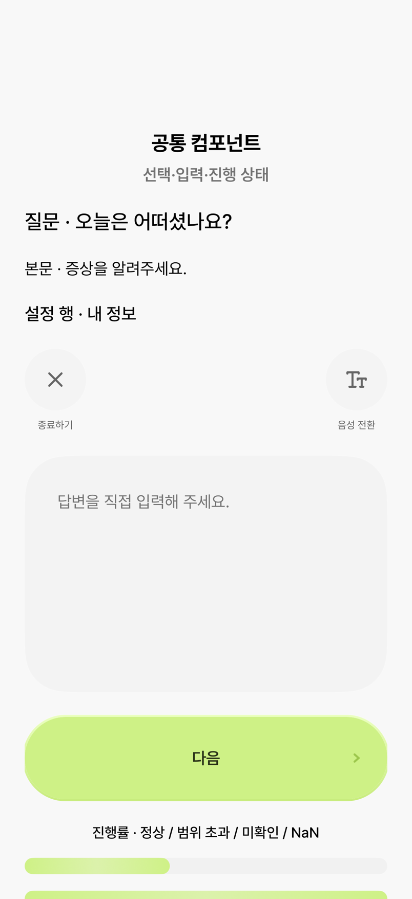

### 진료 전 기록 · 날짜

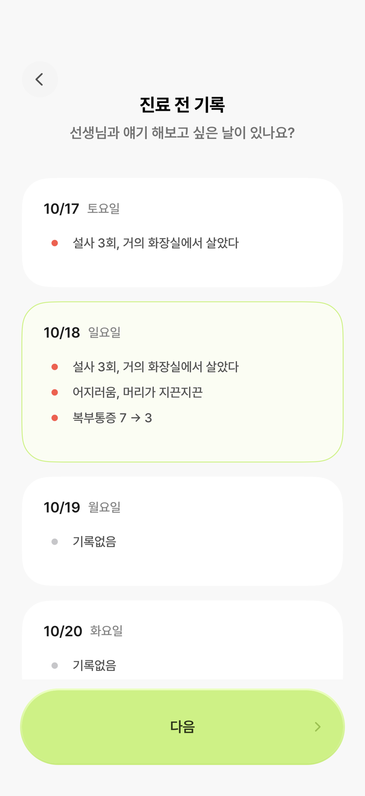

### 진료 전 기록 · 편지

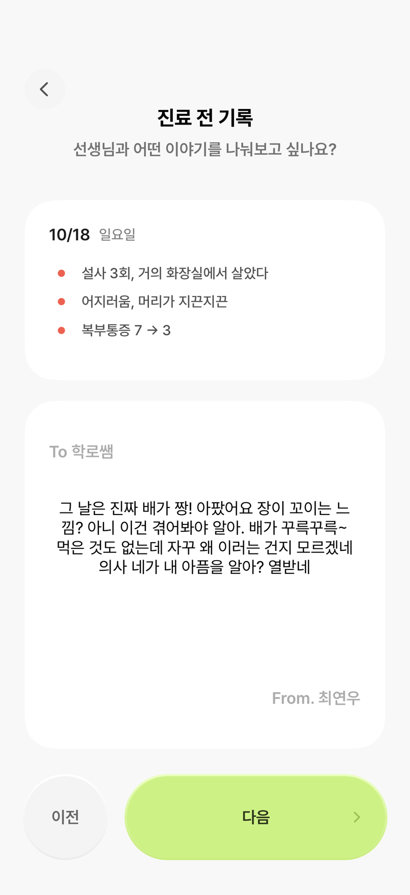

### 진료 전 기록 · 기분

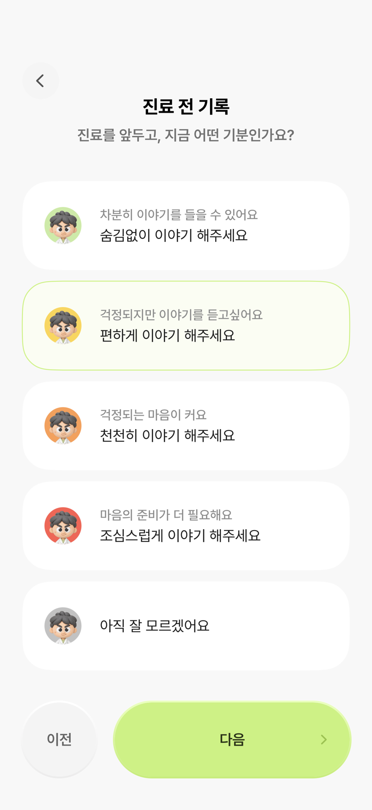

### 알림 목록

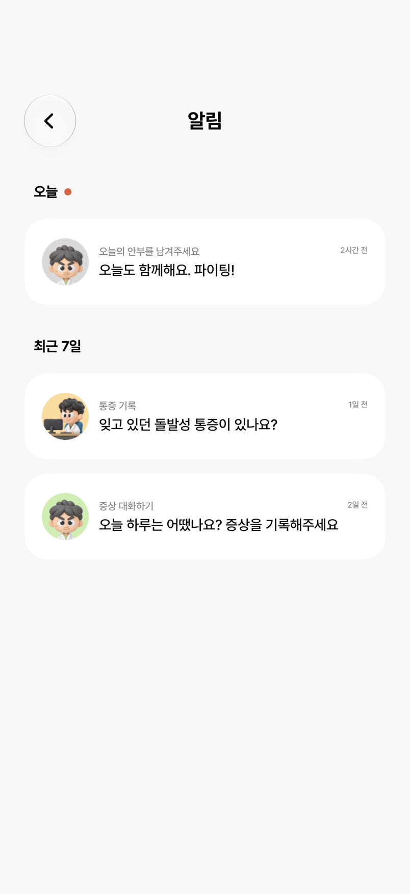

### 케어콜 · 수신

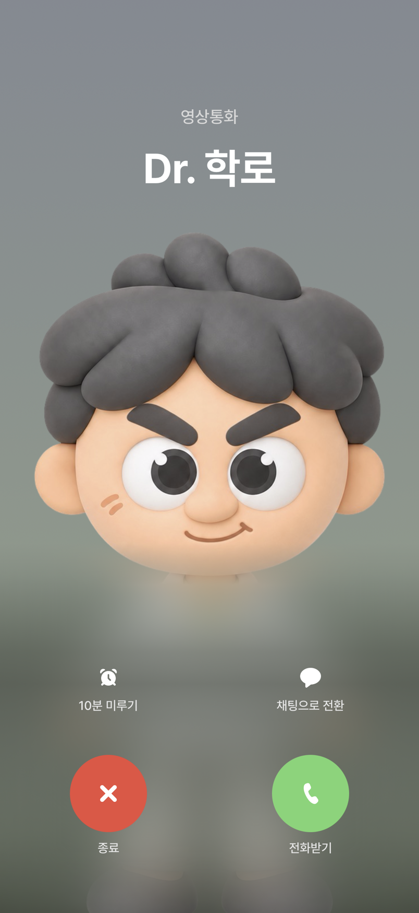

### 케어콜 · 음성 입력

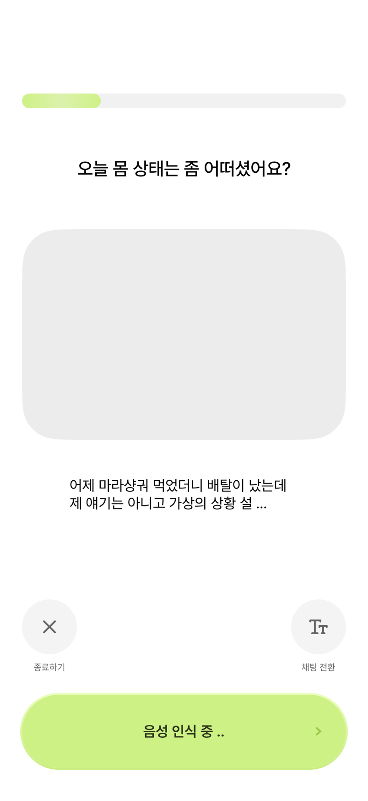

### 케어콜 · 요약

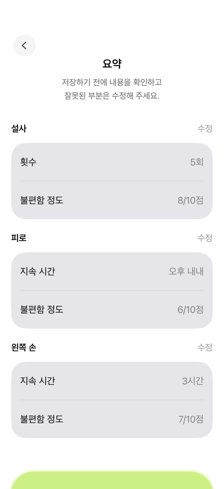

### 수동 · 증상 선택

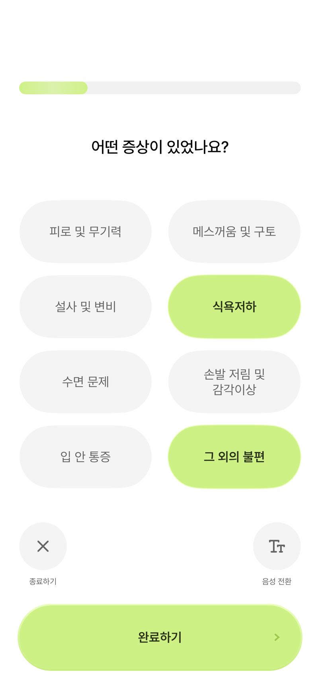

### 수동 · 횟수

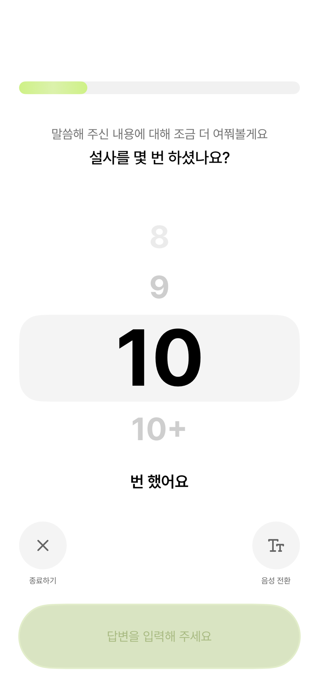

### 수동 · 시간

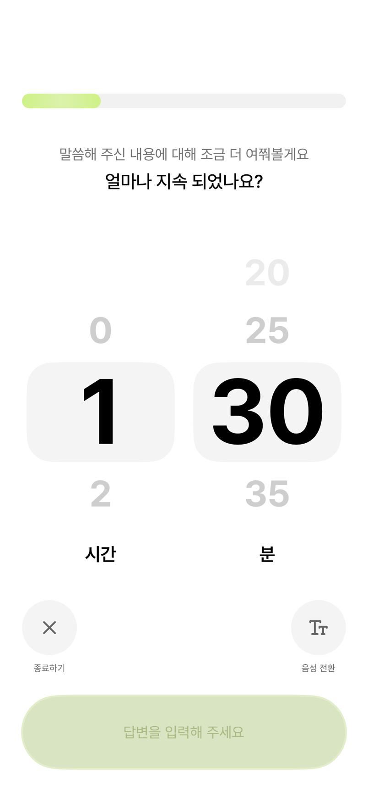

### 통증 · 부위

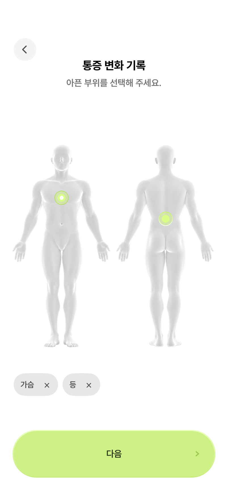

### 통증 · 강도

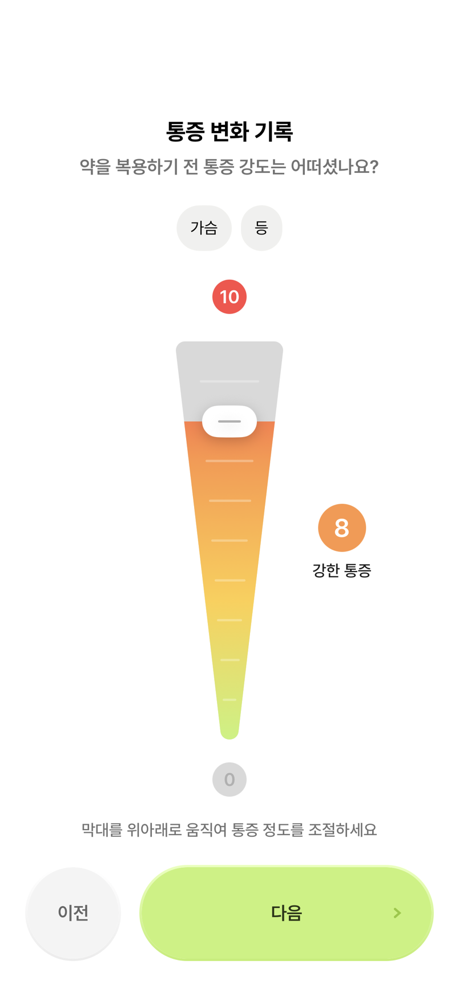

### 통증 · 완료 예시

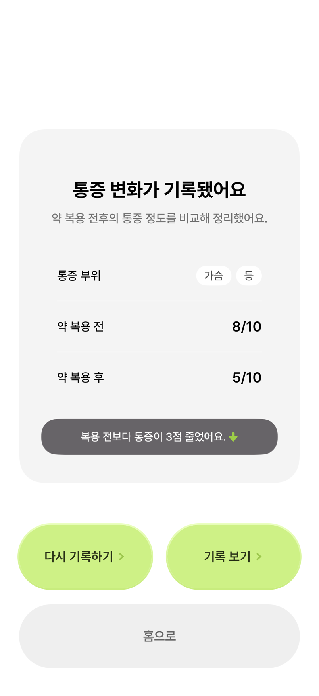

### 마이페이지

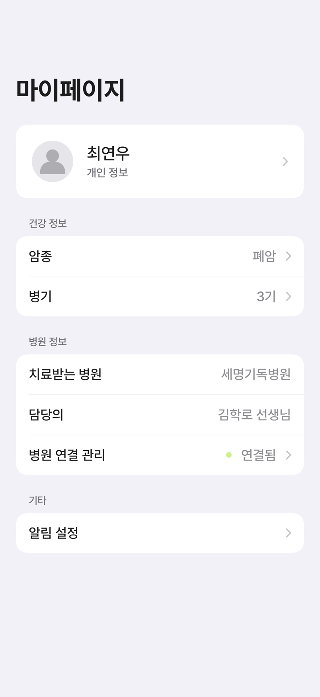

### 개인정보 수정

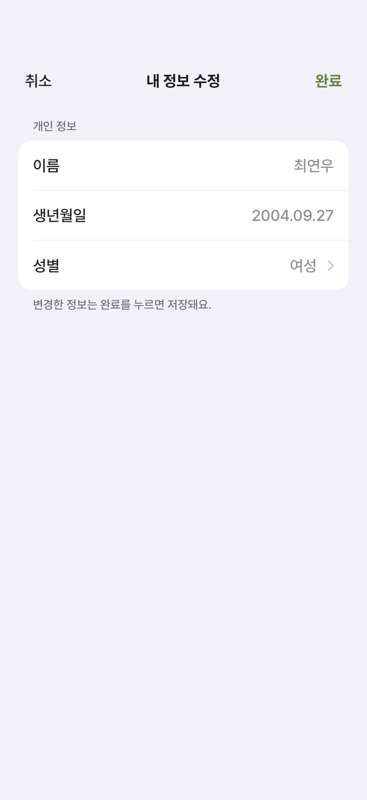

### 케어콜 · 접근성 큰 글자

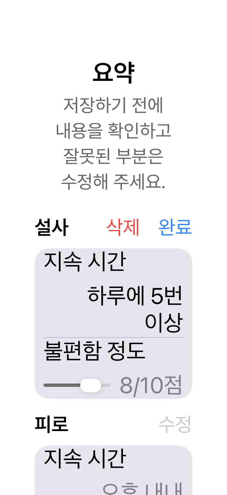
